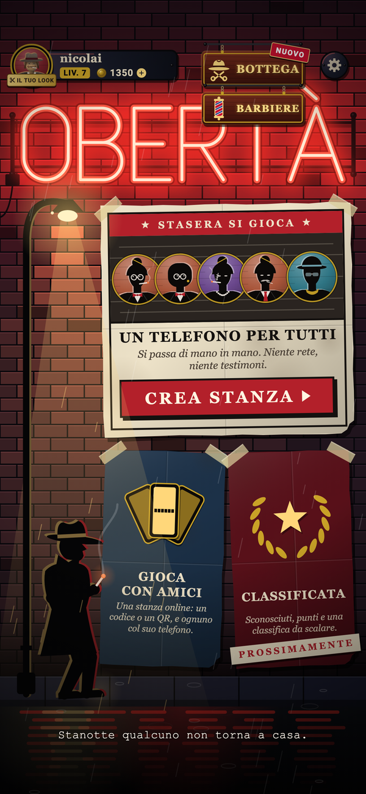
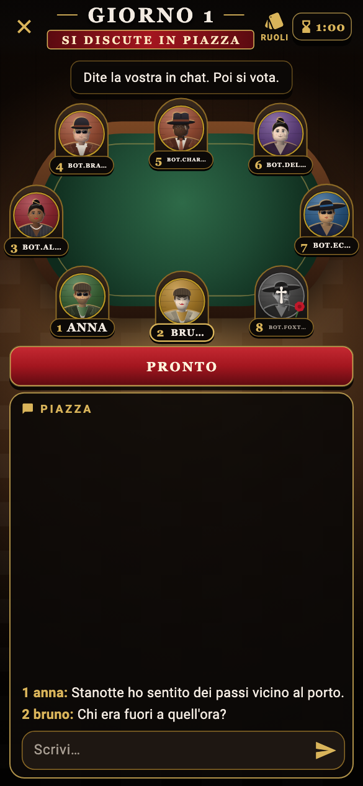
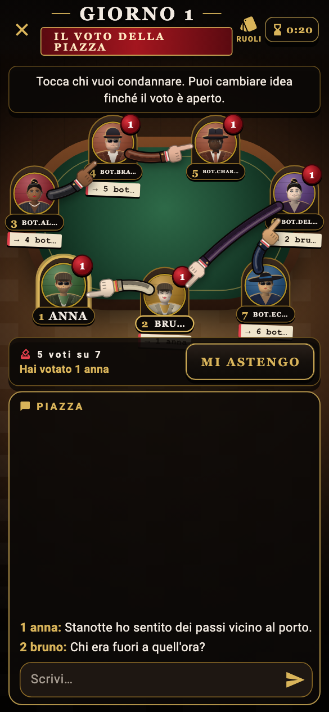
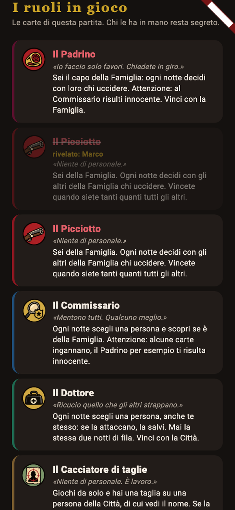
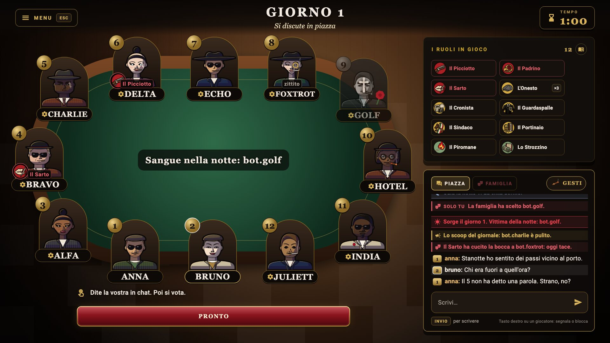

  

<h1 align="center">OBERTÀ</h1>

<b>Chi sa, tace.</b> Il gioco di ruoli segreti in stile noir, da giocare con gli amici.

  
  &nbsp;
  
  &nbsp;
  

---

La città dorme. **La Famiglia no.**
Di notte qualcuno sceglie chi non vedrà l'alba. All'alba il giornale conta i morti. Poi la piazza parla, accusa, mente e vota: chi prende più voti viene linciato e la sua carta si scopre.
Vince la Città se stana gli assassini, vince la Famiglia se resta in piedi. E qualcuno gioca solo per sé.

  
  
  

## Come si gioca

- **Un telefono per tutti** — vi passate il telefono attorno al tavolo e un narratore racconta la notte con la sua voce. Da 4 a 16 giocatori, anche senza rete.
- **Gioca con amici** — una stanza privata con codice o QR: ognuno dal suo telefono o dal PC, chat in piazza di giorno e chat segreta della Famiglia di notte.
- **Classificata** — dodici sconosciuti, un tavolo, il tuo grado in gioco. La sala d'attesa è anonima e chi abbandona non prende niente.

## Ventuno facce, nessuna innocente

La **Famiglia** si conosce e colpisce di notte. La **Città** indaga, protegge e vota. E poi ci sono quelli che giocano **da soli**: il Fesso, il Piromane, il Sicario, lo Strozzino, il Cacciatore di taglie.

## Fatti un nome

Dal **barbiere** scegli la tua faccia, in **bottega** cappelli, completi, cornici, gesti da lanciare al tavolo e le maglie delle squadre del cuore. Le monete si guadagnano solo giocando: niente da comprare per vincere.
Missioni, obiettivi, statistiche e un fascicolo tutto tuo da mostrare agli altri.

## Ovunque

iPhone, e presto Android, PC e Mac su Steam. Lo stesso account, gli stessi progressi, un dispositivo alla volta.

<a href="https://charliemobile.dev/oberta/"><b>charliemobile.dev/oberta</b></a> · © 2026 Nicolai Tana · Charlie Mobile

Per chi sviluppa: le note tecniche sono in [docs/tecnico.md](docs/tecnico.md), la procedura di pubblicazione in [docs/release.md](docs/release.md).
